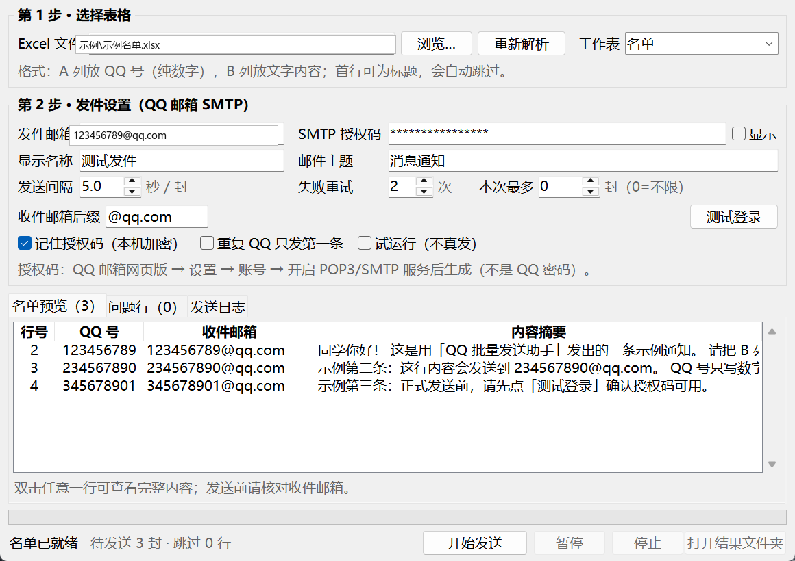

# QQ 批量发送助手

按 Excel 名单，把每一行对应的文字内容，用你自己的 QQ 邮箱逐封发送到该行的 QQ 邮箱
（`QQ号@qq.com`），并生成一份逐行记录成功/失败的结果表。

- 图形界面，双击即可用，不用记命令
- 发送前先预览名单，能直接看到每一封的收件地址
- 支持失败自动重试、发送间隔限速、暂停/停止、试运行
- 授权码用 Windows 本机加密保存，只有这台电脑的这个账户能解开
- 发送结束自动生成 `发送结果_xxx.xlsx`（可筛选）和纯文本发送记录



> 这个仓库只包含源代码。示例名单里的 QQ 号是虚构的；仓库和发布包里**不包含任何真实邮箱、授权码或发送记录**。

---

## 一、两种用法

### 方式 A：直接运行 exe（推荐，免安装）

双击 **`dist\QQ批量发送助手\QQ批量发送助手.exe`** 即可（或双击根目录的 `启动.bat`，它会自动找这个 exe）。
这个文件夹可以整个复制到别的电脑上用，对方不需要装 Python。

`dist\QQ批量发送助手\` 里还有：`使用说明.md`（本文件）、`示例名单.xlsx`、`启动.bat`。

### 方式 B：源码运行（需要 Python）

1. 安装 Python 3.10 或更高版本，安装时勾选 **Add Python to PATH**。
2. 在本目录打开命令行，装一下唯一的依赖：

   ```bat
   python -m pip install openpyxl
   ```

3. 双击 `启动.bat`（或 `python app.py`）。

想把源码打成 exe 分发：双击 `打包成exe.bat`，成功后 exe 在 `dist\` 里。

---

## 二、Excel 名单怎么整理

只认前两列：

| A 列 | B 列 |
| --- | --- |
| QQ号 | 要发送的内容 |
| 123456789 | 同学你好，明天上午九点开会。 |
| 234567890 | 第二条内容（可以多行） |

要点：

- **A 列只写数字**，不要写 `@qq.com`，程序会自动补上收件后缀（默认 `@qq.com`，可改）
- **B 列就是要发出的正文**，换行会原样保留
- **第一行可以是标题**（如 `QQ号` / `内容`），程序会自动跳过；没有标题也行
- 空行自动忽略；号码不合法、内容为空的行会进「问题行」标签并说明原因，不会发送
- 支持 `.xlsx`、`.xlsm`；多个工作表时可以在界面里切换
- 示例文件见 `示例\示例名单.xlsx`（里面的号码是虚构的，请替换）

---

## 三、获取 QQ 邮箱的 SMTP 授权码

> 授权码不是 QQ 密码，是腾讯单独发给程序用的一串字符，可以随时作废。

1. 用浏览器登录 [QQ 邮箱](https://mail.qq.com/)
2. 点顶部 **设置** → **账号**（新版在「账号与安全」里）
3. 找到 **POP3/IMAP/SMTP 服务**，点 **开启**
4. 按提示验证（可能需要短信验证），腾讯会弹出 **授权码**，长这样：`abcdwxyzefghijkl`
5. 把授权码填进软件的「SMTP 授权码」框

如果之前开过、忘了授权码，可以点「生成授权码」重新生成一个（旧的会失效）。

---

## 四、界面使用步骤

1. **选择表格**：点「浏览…」选 Excel，程序自动读取并显示名单预览
2. **填写发件设置**
   - 发件邮箱：你用来发信的完整 QQ 邮箱，如 `123456789@qq.com`
   - SMTP 授权码：上一步拿到的 16 位字符
   - 显示名称：收件人看到的发件人昵称，留空则用邮箱前缀
   - 邮件主题：默认「消息通知」，可用占位符：
     `{qq}` `{email}` `{序号}` `{总数}` `{日期}` `{内容}`（内容前 40 字）
   - 发送间隔：默认 5 秒/封，建议 5–10 秒
   - 失败重试：默认 2 次
   - 本次最多发送：`0` 表示不限，适合先小批量试水
   - 收件邮箱后缀：默认 `@qq.com`，改成别的可发到企业邮箱
   - 重复 QQ 只发第一条：同一个人出现多次时只发一次
   - 试运行：只走流程、不真发信，适合先检查一遍
3. **点「测试登录」**：能连上、能登录就说明授权码没问题
4. **点「开始发送」**：确认框里会显示收件人数和预计耗时
5. 发送中可以 **暂停 / 继续 / 停止**；停止后剩余行记为「未发送」
6. 结束后点 **打开结果文件夹** 查看结果表

---

## 五、结果文件

发送结束会在 Excel 同目录生成两个文件：

- `发送结果_原文件名_年月日_时分秒.xlsx`
  - 「发送结果」表：行号、QQ 号、收件邮箱、状态（成功/失败/未发送/试运行）、时间、失败原因，带筛选和冻结首行
  - 「统计」表：各类数量汇总
- `发送记录_原文件名_年月日_时分秒.txt`：界面日志的完整备份

失败行可以直接在结果表里筛选出来，改完名单后重新发一遍（建议先把失败行复制成新表格）。

---

## 六、常见问题

**提示 535 / 登录失败**
授权码不对、没开启 SMTP 服务，或发件邮箱写错。重新生成授权码再试。
注意：QQ 密码不能用来发信，必须用授权码。

**提示连接超时 / 10060 / 端口拒绝**
公司网络或安全软件拦了 465 端口。程序会自动再试 587 端口；仍失败就换网络（如手机热点）再试。

**提示「发送过于频繁 / exceed / 421」**
腾讯对发信频率有限制。把发送间隔调到 10–20 秒，隔一段时间再发；新号或异地登录的号限制更严，建议先少量试。

**某几封提示「收件地址被拒绝」**
对方 QQ 邮箱未开通、号码不存在或被退信。这类地址重试也没用，跳过即可。

**一次发多少合适**
个人 QQ 邮箱建议一次不超过 50 封、每天总量控制在自己账号的正常范围内。大量群发容易被判为垃圾邮件，导致授权码被限制。需要大批量请用腾讯企业邮箱或专门的邮件服务。

**提示「配置保存失败」或「结果文件写入失败」**
邮件其实已经发出去了，失败只是「保存配置」或「写结果表」这两步。程序会依次换位置保存：
表格所在目录 → 桌面 → 文档 → 临时目录 → 程序所在目录，日志里会写「结果改存到：…」。
如果是从别的工具里启动的程序，可能拿不到这些目录的写权限，直接到文件夹里**双击 exe** 再运行一次就正常了；
即使全部写失败，界面「发送日志」里仍然有每一封的完整结果。

**授权码会不会泄露**
勾选「记住授权码」时，用 Windows 数据保护接口（DPAPI）加密后存到
`%APPDATA%\QQMailerAssistant\config.json`，只有当前 Windows 账户能解密；换电脑或换账户需要重新填写。
不勾选则只在内存里用，关掉软件就没了。

**换电脑 / 重装**
把整个文件夹复制走即可，配置不会跟着走（在新电脑上重新填一次邮箱和授权码）。

---

## 七、目录结构

```
DS-QQ发送助手\
├─ app.py                     程序入口
├─ 启动.bat                   双击启动（优先用 exe，其次用 Python 源码）
├─ 打包成exe.bat              用 PyInstaller 重新打包
├─ dist\QQ批量发送助手\         ← 打包好的绿色版，可直接运行/分发
│  ├─ QQ批量发送助手.exe
│  ├─ _internal\              运行库（不要删）
│  ├─ 使用说明.md
│  ├─ 示例名单.xlsx
│  └─ 启动.bat
├─ qq_mailer\
│  ├─ config.py               配置读写 + 授权码本机加密
│  ├─ excel_io.py             Excel 解析、校验、结果回写
│  ├─ mailer.py               SMTP 发送核心（重试/限速/停止）
│  └─ ui.py                   tkinter 图形界面
├─ assets\app.ico             程序图标
├─ 示例\示例名单.xlsx          格式示例
├─ tests\test_offline.py      离线测试（自建假 SMTP 服务器，不联网）
└─ README.md
```

跑测试（不联网、不会真的发信）：

```bat
python -m unittest discover -s tests -t . -v
```

如果双击 exe 没反应，看它同目录下有没有 `启动错误.log`，里面会记录原因。

---

## 八、使用提醒

- 只给**同意接收**的人发通知类邮件，不要群发广告；被举报会导致你的 QQ 邮箱被限制。
- 请遵守腾讯邮箱服务条款。软件只是把「手动一封封发」变成「按表格自动发」，发信人仍然是你的邮箱，责任也在发信人。
- 建议先用「试运行」+ 小名单（比如发给自己两三个号）验证一遍，再正式群发。
- 邮件正文是纯文本，不解析 HTML；需要排版请自己用换行和空格。
